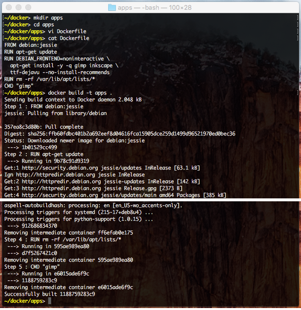

[Docker](https://www.docker.com/) is an excellent tool to deploy apps to servers with tight control over its environment. Apps run inside containers, and have access to a file system, libraries and operating system pre-defined by a Dockerfile. Docker is also available for Mac and PC, which means we can run linux apps on these systems without installing a virtual machine.

Since the apps require a linux environment, docker does not run natively in Mac and PC. Rather, it sets up a linux virtual machine and runs docker engine inside that. Before version 1.12, docker on Mac required installation of virtualbox and docker-machine to manage this linux virtual machine inside which the containers are run. However, latest version of [docker for mac](https://docs.docker.com/docker-for-mac/) uses [hypervisor](https://github.com/docker/hyperkit) to run operating system as a service and thus has more native feel. Lets install it using [Homebrew](http://brew.sh/):

```
brew cask install docker
```

Run the app from the launcher and it will go through the initial setup process. We can now interact with the docker daemon through the shell.

Next, we will pull a debian image and install gimp and inkscape in it. Open a terminal and create a `Dockerfile` inside a folder called `apps`.

```
FROM debian:jessie
RUN apt-get update
RUN DEBIAN_FRONTEND=noninteractive \
  apt-get install -y -q gimp inkscape \
  ttf-dejavu --no-install-recommends
RUN rm -rf /var/lib/apt/lists/*
CMD "gimp"
```

Next, build the docker image called apps:

```
docker build -t apps .
```



To run graphics inside docker containers, we will need X11 running on Mac. At the time of this writing the stable version of XQuartz (2.7.9) has a bug which prevents graphics forwarding. However, 2.7.10\_beta2 works.

```
brew cask install xquartz-beta
```

The stable version of xquartz may work if it is higher than 2.7.10. Check the version in home-brew by: `brew cask info quartz`.

Start XQuartz and allow connections from network clients in preferences > security. Now the following commands should get gimp running:

```
ip=$(ifconfig | grep "inet " | grep -v 127.0.0.1 | awk '{print $2}')
xhost + $ip
docker run --rm -it -e DISPLAY=$ip:0 -v $HOME/Downloads:/root/Downloads apps
```

This will also share the ~/Downloads folder with the container. To run inkscape:

```
docker run --rm -it -e DISPLAY=$ip:0 -v $HOME/Downloads:/root/Downloads apps inkscape
```

Any changes made to gimp itself will be lost when the app is closed. Any additional plugins or customizations should be included in the Dockerfile to make them permanent.
