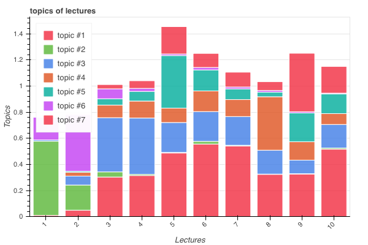

The goal of this project is to use machine learning to identify topics covered in a lecture from the lecture content itself. It can then be used to locate lectures that cover any particular topic of interest.

The program has two parts. First, it learns to identify different subject categories from Wikipedia pages. It does so by training a [Naive Bayes classifier](https://scikit-learn.org/stable/modules/naive_bayes.html) on the documents converted into a bag of words and transformed by a [TF-IDF vectorizer](https://scikit-learn.org/stable/modules/generated/sklearn.feature_extraction.text.TfidfVectorizer.html). To keep things simple, only [glossary pages](https://en.wikipedia.org/wiki/Portal:Contents/Glossaries) on some subjects are used. Then, the classifier is used to identify subjects of lecture texts fetched from the [MIT OpenCourseWare website](https://ocw.mit.edu/).

In the second part, [Non-Negative Matrix Factorization (NMF)](https://scikit-learn.org/stable/modules/generated/sklearn.decomposition.NMF.html), a popular method for topic modelling, groups together phrases that are likely to form a particular topic. The most frequent phrases from the dominant topic in each lecture are used to make a list of keywords for each lecture.

The app was developed in Python using the scikit-learn machine learning library and the Django web framework, and hosted on AWS Elastic Beanstalk.

