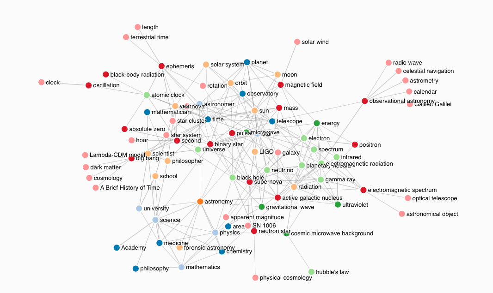

The goal of this project is to construct a knowledge graph that shows how various concepts are related to each other. These relationships help construct the natural path from a basic concept to a more advanced one, and outline the concepts that must be covered to fully understand a topic. The graph also serves as a tool to identify topics in a text such as an article or lecture transcript.

For the prototype, the program analyzed about 20,000 Wikipedia pages containing the term [astronomy](https://en.wikipedia.org/wiki/Astronomy) to build a knowledge graph that identifies not only the important terms, but also how they are connected to each other. It is shown as an interactive graph using the [d3.js](https://d3js.org/) graphics library. Each node represents a term relevant to astronomy, and the width of the line joining two nodes corresponds to the strength of the connection between them. Nodes of the same order (connected directly to astronomy are order 1, those through another node are order 2, and so on) share a colour.

The strongest connections between a target concept and astronomy can be found by entering a term in the search box. The program analyzes all paths containing up to six intermediate nodes to find the best three. It works reasonably well for common subtopics of astronomy, but currently favours longer connections, and the search algorithm needs more optimization.

