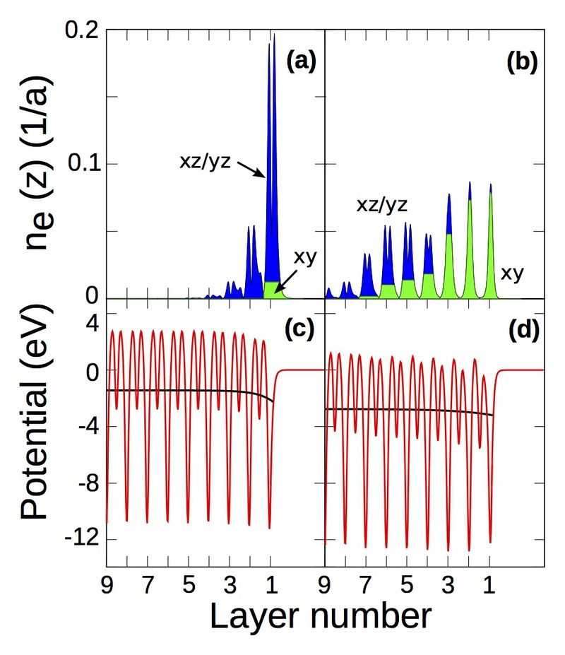
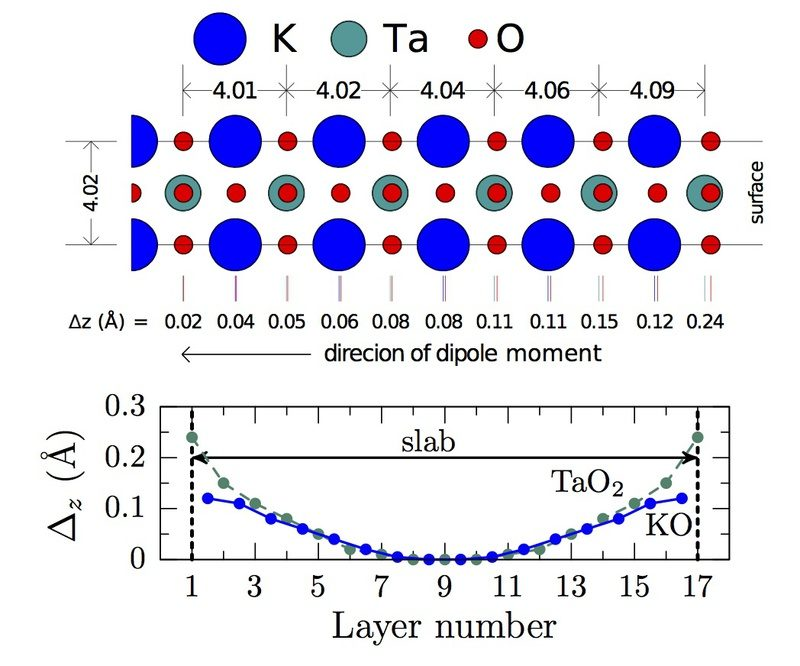
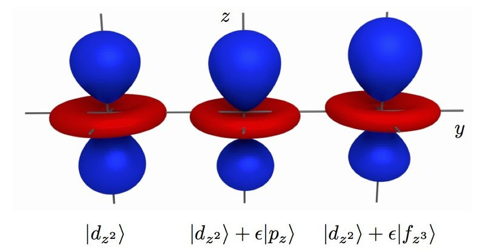
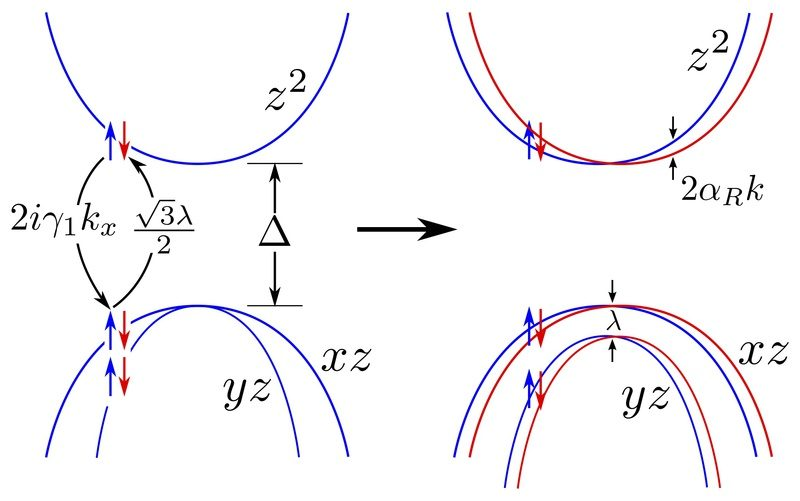

The Rashba effect, or Rashba-Dresselhaus effect, is a momentum-dependent splitting of spin bands in two-dimensional condensed matter systems. Consider a particle with charge and spin moving with velocity $v$ through an electric field $E$. It feels a magnetic field

$$
B = -\frac{v\times E}{c^2} = -\frac{p\times E}{m_c c^2}
$$

The spin of the particle couples to this field through the Hamiltonian

$$
H_{SO} = -\mu_B\,\sigma\cdot \left(\frac{p\times E}{2m_c c^2}\right)
$$

which can be rewritten in the Rashba form $H_R = \alpha_R(\hat{z}\times k)\cdot \sigma$.

**2DEG on a polar surface.** The 2D electron gas density (top) and the local potential (bottom) for a slab of KTaO₃ in the unrelaxed (left) and relaxed (right) structures, from density functional theory. The TaO₂ layers are numbered on the x axis, with the surface layer marked 1. Structural relaxation substantially weakens the surface potential.

**Structural relaxation.** The relaxed structure of the KTaO₃ slab in the first six layers near the surface, beyond which there is no significant distortion. The lower panel shows the change of the cation-anion distance Δz in each layer due to relaxation, with layers 1 and 17 being the two surface Ta layers.

**Perturbed orbitals.** Contour plot of the $3d_{z^2}$ orbital showing the effect of electric-field induced mixing with the $p_z$ and $f_{z^3}$ orbitals at ε = 0.3. Colours distinguish the signs of the wave function.

**Perturbation theory.** Rashba spin splitting through second-order perturbation theory. The bands on the left are spin degenerate. The $d_{z^2}\uparrow$ band interacts with $d_{xz}\uparrow$ through the electric field ($2i\gamma_1 k_x$), while the $d_{z^2}\downarrow$ band interacts with $d_{xz}\uparrow$ through spin-orbit coupling ($\sqrt{3}\lambda/2$). Together they split the up and down bands, as shown on the right.
